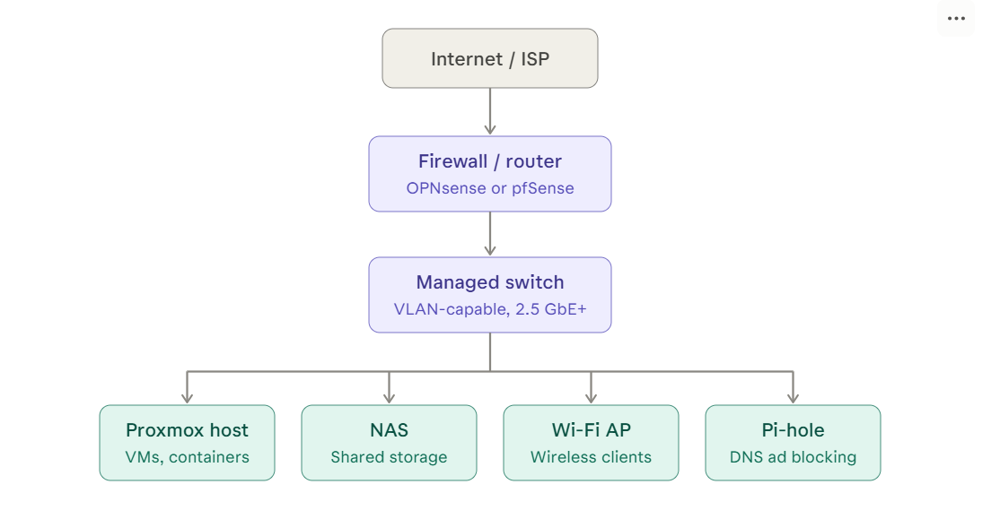

# Home Lab for practicing virtualisation and networking

This lab is a hands-on environment for practising real networking and security skills outside the classroom. It includes what went wrong and how it was diagnosed.

## Lab Architecture

| Component | Role |
|---|---|
| **Host Machine** | Windows 11, running VirtualBox |
| **OPNsense VM** | Firewall and router between the internal lab and the host network |
| **Ubuntu VM** | Internal client machine — primary lab workstation |
| **Kali Linux VM** | Offensive security and pen-testing *(planned)* |
| **Windows Server VM** | Target machine for security testing *(planned)* |

All internal VMs sit behind OPNsense on an isolated virtual network. OPNsense acts as the gateway — the same role a physical firewall plays in a real network. Traffic from the internal VMs must pass through OPNsense to reach the outside world

<strong>Network Topology</strong>

## Lab and Practical work 

### 1 — Ubuntu VM Setup

Installed Ubuntu Server on HyperV and confirmed internet connectivity. Noticed the VM received a `10.0.2.15` address rather than a `192.168.x.x` address, and diagnosed this as VirtualBox NAT mode creating its own private network inside the host.

**Key takeaway:** documented the NAT traffic flow —

---

### 2 — OPNsense Firewall

Installed the OPNsense VM with two network adapters (WAN and LAN) and configured it as the lab's gateway. Assigned the interfaces, set the internal LAN subnet, and added initial firewall rules so internal VMs can reach the internet through OPNsense while staying isolated from the host network.

---

### 3 — Network Monitoring

- Install a monitoring tool (Security Onion or similar)
- Capture and analyse traffic passing through OPNsense
- Baseline normal traffic, then generate test events to confirm detection works

---

### 4 — Attack & Detect(Planned)

- Use Kali Linux to run controlled attacks against lab targets
- Observe how that traffic appears in the monitoring tools
- Document what malicious activity looks like on the wire vs. normal activity

---

### 5 — Automation

- Write scripts to automate backups, log parsing, or alerting
- Document what was automated and why

