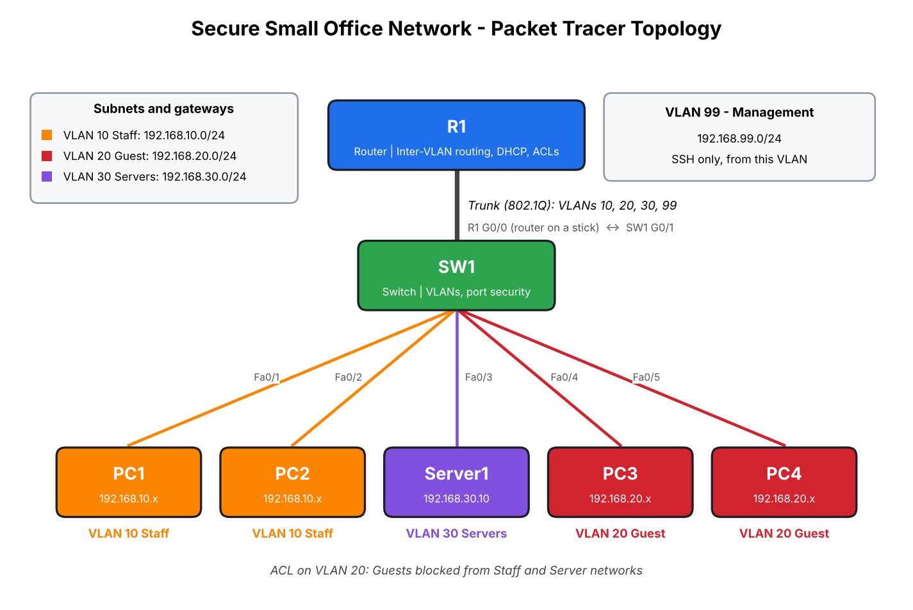

# Secure Small Office Network (Cisco Packet Tracer)

A Cisco Packet Tracer lab that designs, builds and secures a small office network using VLAN segmentation, inter-VLAN routing, DHCP, access control lists (ACLs), SSH and switch port security.




## Overview

This project simulates a small office with separate departments on their own VLANs. The network gives each department the access it needs, blocks traffic that should not cross between them, and hardens the routers and switches against common access and layer 2 attacks.

## Objectives

- Design a segmented network with routers, switches, servers and end devices.
- Configure VLANs, trunking and inter-VLAN routing.
- Provide automatic addressing with DHCP.
- Control traffic between departments using ACLs.
- Secure device management with SSH and strong local credentials.
- Reduce layer 2 risks with port security and by disabling unused ports.
- Test and verify the network, and document the configuration and findings.

## Network Design

### Devices

| Device | Model | Role |
| --- | --- | --- |
| R1 | Cisco 2911 | Router, inter-VLAN routing, DHCP, ACLs |
| SW1 | Cisco 2960 | Access switch with VLANs and port security |
| Server1 | Server-PT | Internal web/DNS server |
| PC1 to PC4 | PC-PT | End-user workstations |

### VLANs and IP Addressing

> Update these tables to match your own topology.

| VLAN | Name | Subnet | Gateway |
| --- | --- | --- | --- |
| 10 | Staff | `192.168.10.0/24` | `192.168.10.1` |
| 20 | Guest | `192.168.20.0/24` | `192.168.20.1` |
| 30 | Servers | `192.168.30.0/24` | `192.168.30.1` |
| 99 | Management | `192.168.99.0/24` | `192.168.99.1` |

**VLANs and trunk on the switch**

```
vlan 10
 name Staff
vlan 20
 name Guest
vlan 30
 name Servers
vlan 99
 name Management

interface GigabitEthernet0/1
 switchport mode trunk
 switchport trunk allowed vlan 10,20,30,99
```

**Inter-VLAN routing (router on a stick)**

```
interface GigabitEthernet0/0.10
 encapsulation dot1Q 10
 ip address 192.168.10.1 255.255.255.0
```

**DHCP**

```
ip dhcp pool STAFF
 network 192.168.10.0 255.255.255.0
 default-router 192.168.10.1
```

**ACL: block guests from the server and staff networks**

```
ip access-list extended GUEST-RESTRICT
 deny ip 192.168.20.0 0.0.0.255 192.168.30.0 0.0.0.255
 deny ip 192.168.20.0 0.0.0.255 192.168.10.0 0.0.0.255
 permit ip any any

interface GigabitEthernet0/0.20
 ip access-group GUEST-RESTRICT in
```

**SSH for secure management**

```
hostname R1
ip domain-name [example.local]
crypto key generate rsa modulus 2048
username admin secret <strong-password>
ip ssh version 2
line vty 0 4
 login local
 transport input ssh
```

**Port security and unused ports**

```
interface FastEthernet0/5
 switchport mode access
 switchport port-security
 switchport port-security maximum 2
 switchport port-security violation shutdown

interface range FastEthernet0/10 - 24
 shutdown
```

> **Security note:** The passwords shown are placeholders. Never commit real credentials to a public repository.

## How to Run

1. Install [Cisco Packet Tracer](https://www.netacad.com/) (free with a Cisco Networking Academy account).
2. Clone this repository:
   ```
   git clone https://github.com/<your-username>/<your-repo>.git
   ```
3. Open `packet-tracer/[project-name].pkt` in Packet Tracer.
4. Wait for the network to converge, then follow the test steps below.

## Testing and Verification

| Test | Expected Result | Result |
| --- | --- | --- |
| Staff PC receives an address by DHCP | Valid address and gateway | Pass |
| Staff PC pings Server1 | Replies received | Pass |
| Guest PC pings Server1 | Blocked by ACL | Pass |
| Guest PC reaches the internet or external network | Allowed | Pass |
| SSH to R1 from the Management VLAN | Login succeeds | Pass |
| Telnet to R1 | Connection refused | Pass |
| Connect an unauthorised device to a secured port | Port shuts down | Pass |

Useful verification commands:

```
show vlan brief
show ip interface brief
show access-lists
show ip ssh
show port-security interface FastEthernet0/5
```

## What I Learned

- How VLANs separate departments and reduce the impact of a compromise.
- How ACLs control which networks can communicate, and why rule order matters.
- Why SSH replaces Telnet for management, and how port security limits layer 2 attacks.
- How to troubleshoot connectivity using ping, trace and show commands.
- How to document a network design and configuration clearly.

## Skills Demonstrated

Network design, VLANs, trunking, inter-VLAN routing, DHCP, ACLs, SSH hardening, port security, network security, troubleshooting, technical documentation.

## Author

**Prachi Chaurasia**
